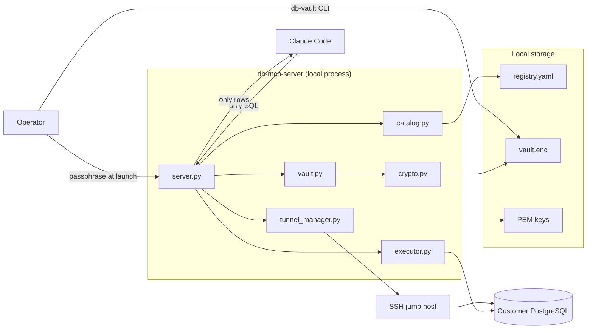
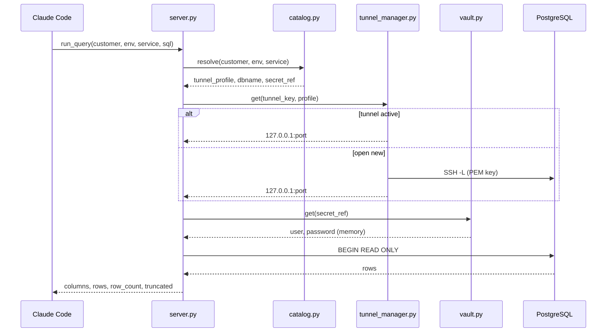
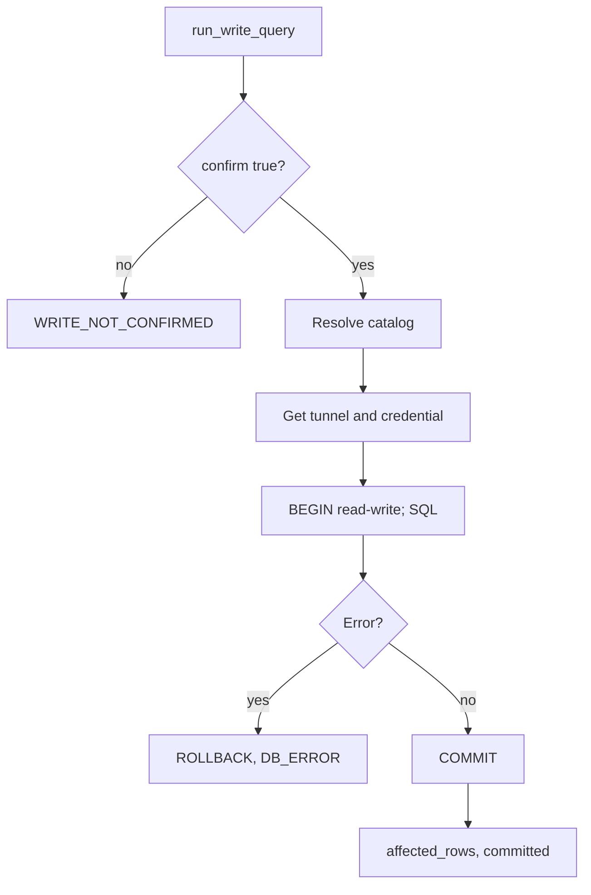
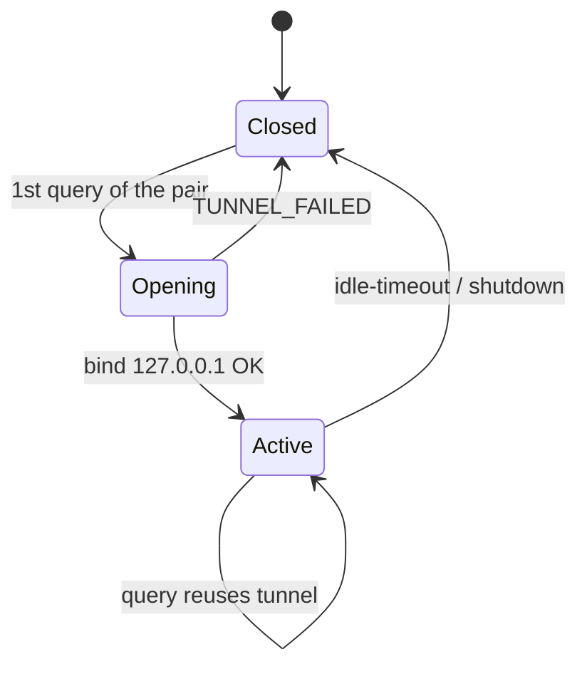
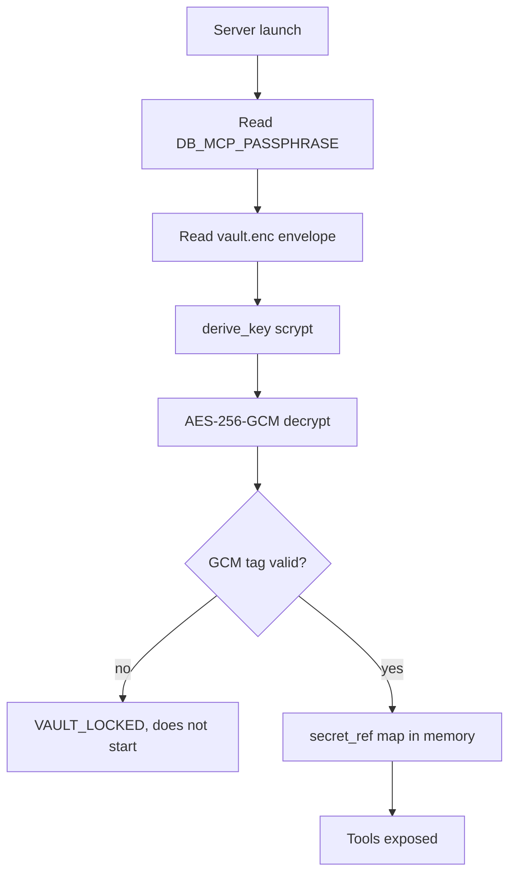
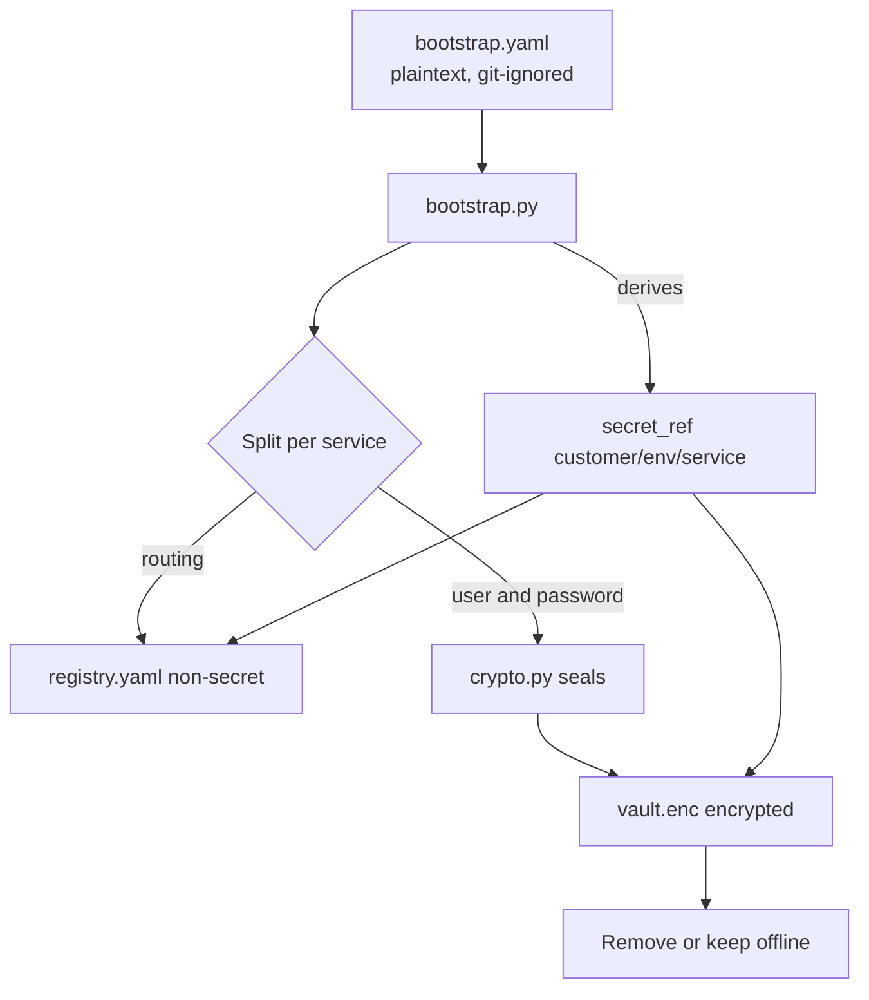
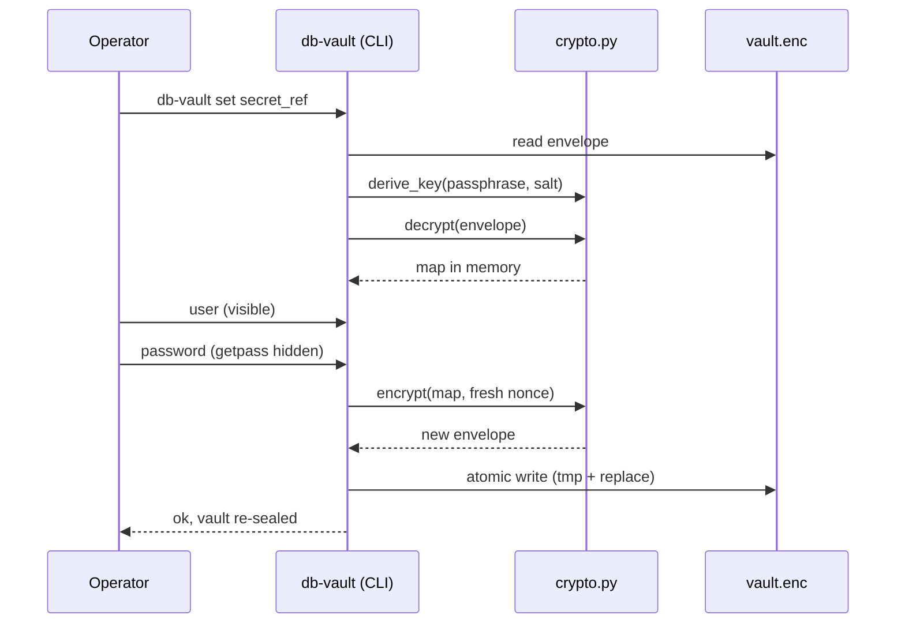
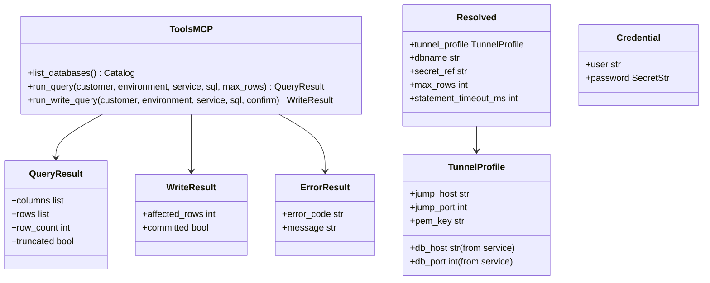
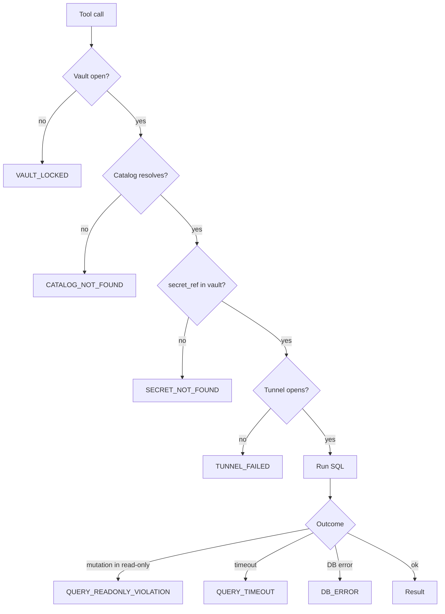
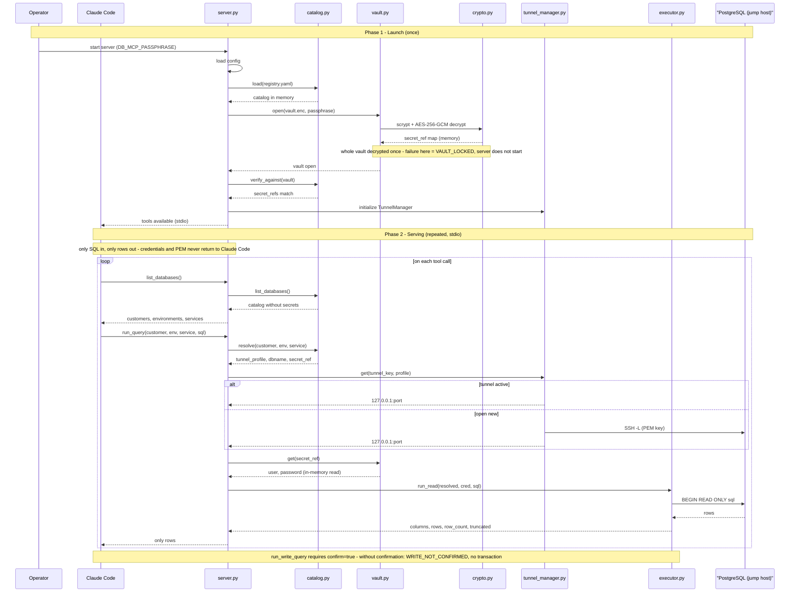

# Mermaid Diagrams - db-mcp-server

## Overview

db-mcp-server is a local MCP server (Python, stdio transport) that gives Claude Code routed, credential-isolated access to the PostgreSQL databases. The model sends only SQL and receives only result rows; database credentials and jump-host PEM keys never enter the model's context. Reads are read-only by default (a Postgres `READ ONLY` transaction) and writes require explicit per-call confirmation. These diagrams describe Phase 1: a local passphrase-encrypted vault, SSH tunnels reused per customer, initial import via `bootstrap.yaml`, and an out-of-band credential-write path.

## Identified Elements

### External flows
- The Operator supplies the passphrase at launch, imports initial data with `db-bootstrap`, and manages credentials via the `db-vault` CLI.
- Claude Code (MCP client) invokes the tools `list_databases`, `run_query`, `run_write_query`.
- PostgreSQL databases, reached over an SSH tunnel through jump hosts.

### Internal processes
- `server.py` exposes the tools via FastMCP and orchestrates the flow.
- `catalog.py` resolves `customer`/`environment`/`service` from `registry.yaml`.
- `tunnel_manager.py` keeps a tunnel pool per `(customer, environment, db_host, db_port)` with ephemeral ports.
- `vault.py` decrypts the vault into memory at launch and returns credentials by `secret_ref`.
- `crypto.py` derives the key (scrypt) and seals/decrypts (AES-256-GCM) with an atomic write.
- `executor.py` opens a psycopg connection and runs in read-only or confirmed read-write mode.
- `bootstrap.py` splits `bootstrap.yaml` into `registry.yaml` and `vault.enc`.

### Behavioral variations
- `run_query` always in a `READ ONLY` transaction; a mutation is rejected by the engine.
- `run_write_query` opens a read-write transaction only with `confirm=true`.
- A tunnel is reused if active, or opened on demand on the first query for the `(customer, environment, db_host, db_port)` endpoint.

### Public contracts
- MCP tools: `list_databases`, `run_query`, `run_write_query`.
- Pydantic models: `Catalog`, `QueryResult`, `WriteResult`, `Resolved`, `Credential`, `TunnelProfile`, `ErrorResult`.
- Files: `registry.yaml` (non-secret), `vault.enc` (encrypted), and `bootstrap.yaml` (plaintext, transient and git-ignored).
- Error enum: `CATALOG_NOT_FOUND`, `VAULT_LOCKED`, `TUNNEL_FAILED`, `QUERY_READONLY_VIOLATION`, `WRITE_NOT_CONFIRMED`, `QUERY_TIMEOUT`, `SECRET_NOT_FOUND`, `DB_ERROR`.

## Diagrams

### Architecture and security boundary

This flowchart shows the static component architecture and the system's central security boundary. It makes visible that only SQL flows in and only rows flow out between Claude Code and the server, while credentials, PEM keys, and the encrypted vault stay on the inside. Use it to understand which modules exist, where the local stores live, and why the model never sees secrets. It is the highest-level view before drilling into the execution flows.

**Notes**:
- The `db-mcp-server` boundary isolates credentials and PEM: only SQL and result rows travel between Claude Code and the server.
- Credential writes do not go through any MCP tool; they are done by the Operator via the `db-vault` CLI directly against `vault.enc`.
- `executor.py` connects to Postgres through the ephemeral local port opened by `tunnel_manager.py`.

---

### Main read flow

This sequence diagram represents the end-to-end execution of a `run_query` call, the system's most important path. It shows the temporal order between Claude Code, the internal modules, and PostgreSQL, including the decision to reuse or open an SSH tunnel. Use it to understand what happens on each read query and where the credentials are obtained in memory. It is the best reference for runtime behavior.

**Notes**:
- The vault is decrypted in full into memory at server launch; `get(secret_ref)` is just a read of the in-memory map, never a per-call decryption.
- The `READ ONLY` transaction guarantees that any mutation is rejected by the Postgres engine itself.
- `max_rows` caps the result and sets `truncated=true` when the cut occurs.

---

### Write flow

This top-down flowchart describes the logic of `run_write_query`, highlighting the confirmation decision that separates a deliberate write from a call with no effect. It shows that, without `confirm=true`, no read-write transaction is opened, and that errors result in a `ROLLBACK`. Use it to understand the explicit barrier against accidental mutations and the `COMMIT`/`ROLLBACK` outcome. It is central to the system's deliberate-write guarantee.

**Notes**:
- Without `confirm=true` the tool returns `WRITE_NOT_CONFIRMED` without opening a transaction or touching the database.
- Catalog, tunnel, and credential resolution reuses the same steps as the read flow.
- On error the transaction is rolled back and the return is a structured error with no credentials.

---

### Tunnel lifecycle

This state diagram represents the lifecycle of an SSH tunnel managed by `tunnel_manager.py` for each `(customer, environment, db_host, db_port)` endpoint. It shows the on-demand opening on the first query, reuse while active, and closing on idle-timeout or shutdown. Use it to understand the at-most-one-tunnel-per-customer-environment-and-DB-host policy and how open failures are handled. It is essential to the efficient-tunnel-reuse goal.

**Notes**:
- A tunnel is shared by all services of the same `(customer, environment)` that use the same DB host.
- The local port is ephemeral on `127.0.0.1`, obtained with `local_bind_address=('127.0.0.1', 0)`.
- After idle-timeout the tunnel is closed; the next query transparently reopens it.

---

### Opening the vault

This top-down flowchart details the cryptographic process of opening the vault at server launch, combining scrypt key derivation and authenticated AES-256-GCM decryption. It shows that a missing or wrong passphrase makes the GCM tag check fail and the server does not start, returning `VAULT_LOCKED`. Use it to understand why secrets stay encrypted at rest and how the vault's authenticity is validated. It is the explanation of the non-obvious algorithm behind the vault.

**Notes**:
- The envelope header stores the `salt`, the scrypt parameters, and the `nonce` in clear; only the credential map is encrypted.
- The passphrase is never persisted; it exists only in memory during execution.
- Without the vault open no tool operates (decrypt-all-at-launch).

---

### Bootstrap — credential split

This top-down flowchart describes the initial import done by `bootstrap.py`, which reads a single `bootstrap.yaml` (same shape as `registry.yaml`, but with plaintext `user`/`password` per service) and splits it into two halves. The non-secret routing half goes to `registry.yaml`; the credentials are sealed into `vault.enc` via `crypto.py`, and each service's `secret_ref` is derived as `customer/env/service`, linking the two halves. Use it to understand the cutover from the source configuration and why `bootstrap.yaml` is git-ignored and should be removed or kept offline once the vault is generated. It is the basis of the routing-vs-secret separation.

**Notes**:
- `bootstrap.yaml` contains plaintext credentials; it is git-ignored (template: `bootstrap.example.yaml`) and should be removed or kept offline once the vault is generated.
- The derived `secret_ref` (`customer/env/service`) is the key that links the routing entry in `registry.yaml` to the credential in `vault.enc`.
- `--dry-run` shows the summary without writing; `--force` is required to overwrite an existing `vault.enc`. It never prints credential values.

---

### Credential administration (out of band)

This sequence diagram shows the incremental credential-write path into the vault, run by the Operator via the `db-vault` CLI, without going through any MCP tool. It makes clear that the password is read from a hidden prompt (`getpass`), that the vault is re-encrypted with a fresh nonce, and that it is written atomically. Use it to understand why the password never enters the model's context or command-line arguments. It is the basis of the out-of-band credential-write guarantee after the initial bootstrap.

**Notes**:
- The passphrase comes from `DB_MCP_PASSPHRASE` or a prompt; the DB password is never passed via argv.
- Every write uses a fresh random nonce, an AES-GCM requirement, and never reuses the previous nonce.
- After adding a new `secret_ref` the server must be restarted, which decrypts the vault at launch.

---

### Public contracts

This class diagram gathers the server's public contracts: the three MCP tools and the Pydantic output and routing models. It shows that no tool accepts or returns `user`, `password`, DSN, or PEM, and that the credential (`Credential`) is internal, referenced by `secret_ref`. Use it as an integration reference for anyone consuming the tools or extending the models. It is the stable specification of the exposed interfaces.

**Notes**:
- `Credential` is internal to the server and never appears in the tools' input or output.
- Errors are returned as `ErrorResult` with an `error_code` (enum) and a `message` without secrets.
- `Resolved` is the internal result of `catalog.resolve`, linking routing and `secret_ref`.

---

### Error handling

This top-down flowchart maps where each `error_code` arises along a query's pipeline, from vault to database. It shows the sequence of barriers (vault open, catalog resolves, `secret_ref` present, tunnel opens, SQL execution) and the error corresponding to each failure. Use it to diagnose which step produced an error and to confirm that early failures have no side effects. It is the consolidated view of the system's resilience.

**Notes**:
- `CATALOG_NOT_FOUND` and `SECRET_NOT_FOUND` fail before any tunnel or connection, with no side effects.
- `QUERY_READONLY_VIOLATION` occurs when a mutating SQL statement is sent to `run_query`.
- `WRITE_NOT_CONFIRMED` belongs to the write flow and is handled in the write diagram.

---

### Full server process (launch and serving)

This sequence diagram represents the full db-mcp-server process over its lifetime, in two phases within a single timeline. The first phase is launch (once): the Operator starts the server with the passphrase in `DB_MCP_PASSPHRASE`, which loads config, runs `Catalog.load`, opens the vault by decrypting `vault.enc` in full into memory via scrypt and AES-256-GCM, verifies the `secret_ref`s against the vault, and initializes the `TunnelManager`. The second phase is serving (repeated, over stdio): it briefly shows `list_databases` and, in detail, a `run_query`, making clear that the vault is decrypted only at launch and that `vault.get` is just an in-memory read, never a per-call decryption. Use it as the highest-level view of runtime behavior, complementing the focused read flow.

**Notes**:
- The vault is decrypted in full once at launch (decrypt-all-at-launch); at runtime `vault.get(secret_ref)` is just a read of the in-memory map, never a per-call decryption.
- A failure to open the vault (missing or wrong passphrase) makes the server not start and report `VAULT_LOCKED`; no tool operates without the vault open.
- `list_databases` responds only with the navigable catalog, without `secret_ref`, jump host, or PEM.
- The tunnel is reused when active or opened on demand with the PEM key; the ephemeral port on `127.0.0.1` is used by `executor.py` to open the psycopg connection.
- The security boundary holds in both phases: only SQL and rows travel between Claude Code and the server; credentials and PEM never return to the model.
- `run_write_query` opens a read-write transaction only with `confirm=true`; without confirmation it returns `WRITE_NOT_CONFIRMED` without touching the database.
